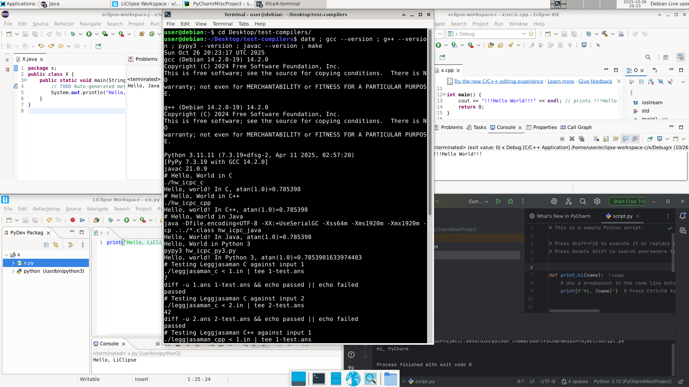

# A Debian-based LiveCD builder for ICPC

## Summary

A 64-bit Debian Live installation for the International Collegiate Programming Competition (ICPC).

Includes: gcc, g++, Java, PyPy 3, Eclipse (for C, C++, and Java), LiClipse, PyCharm, Visual Studio Code, Vim, Emacs, and gdb.
Locked down to prevent user administrative access, and limits all outbound network traffic to a preconfigured Squid proxy server.
Currently preconfigured for the US Mid-Central region proxy server, and only administerable via root ssh key.

As with any normal Debian Live installation, it can be booted into a RAMdisk to avoid modifying the host system at all, and the ISO can be used to make a bootable flash drive.
As of 2026, an ISO containing the base environment, two Eclipse installations (C/C++ and Java), LiClipse, PyCharm, and Visual Studio code is under 3.2 GB (or under 3.0 GiB).
PyCharm represents about 1 GB of that total.

Theoretically, this environment will also build a README.html on the live user's desktop.
This can contain any site-specific notes you want your teams to have, and can automatically populate sections with details about your installed compilers, compiler options, and IDEs.

## Build requirements

- Debian amd64 installation (tested on 13.7, may work on earlier versions)

## Basic Usage

1. Read through `build.sh` and the files under `debian-live/config`.
2. Run `./build.sh` or `./build.sh allow-internet` as any user with `sudo` privileges.
3. Copy the resulting `~/icpc-livecd-*-amd64.hybrid.iso` to media and boot.

**The `allow-internet` build will allow full outbound Internet access for teams to practice with, and should not be used for an actual contest.**

Typical variables in `build.sh`:

- `WORKDIR=~/icpc`, where the Debian Live build will do most of its work.
- `LANGUAGES="c c++ java python"`, a space-separated string of supported languages (see the "Modularized programming language support" section below for details on adding additional languages, or making changes to the existing ones)
- `SQUID_IP`, a value matching the IP address of your Squid proxy server (hostname support may come later)

Other variables that may be used:

- `ECLIPSE_RELEASE=2026-09`, `ECLIPSE_LANGUAGES="cpp java"`, `ECLIPSE_MIRROR=mirror.umd.edu` that are used for Eclipse installations
- `LICLIPSE_RELEASE=12.0.1` used for LiClipse installations
- `PYCHARM_RELEASE=2026.2.3` used for PyCharm installations

## Administration

1. For normal usage, replace the `authorized_keys` file in `debian-live/config/includes.chroot/root/.ssh` and rebuild the image.
2. If you need to install other packages on the live system, or otherwise need network access, run `shorewall stop` to disable the firewall, and unset the needed the `*proxy` variables that were set from `/etc/environment`: `http_proxy`, `https_proxy`, `ftp_proxy`, `HTTP_PROXY`, `HTTPS_PROXY`, `FTP_PROXY`. Once you're done, restart shorewall with `shorewall start`.

## Internals

### Modularized programming language support (adding support for a new programming language)

The `languages` folder contains scripts, Markdown files, and other configurations needed to support a new programming language. It includes: `1.ans`, `1.in`, `2.ans`, `2.in` from the [Leggja saman Kattis problem](https://open.kattis.com/problems/leggjasaman?tab=metadata), applicable to all supported languages.

Each supported language gets its own `languages/LANGUAGE` folder containing:

- a `test-compilers` folder containing:
  - a source file solving the [Legga saman Kattis problem](https://open.kattis.com/problems/leggjasaman)
  - a source file containing a basic "Hello, World!" that also demonstrates basic math support
  - a Makefile named `Makefile_LANGUAGE` that matches Kattis standards for compilers and options. Typically, this Makefile will be parsed by `LANGUAGE_filter_md.sh` (described below) to create documentation for competing teams.
- `LANGUAGE.md`: a description of the compiler used for that language and how to use it. It should closely, if not identically, match Kattis instructions shown in pages like [Kattis Java support](https://open.kattis.com/languages/java). It usually ntains template placeholders like `__JDK_VERSION__` that `LANGUAGE_filter_md.sh` will be replace with site-specific details about the language.
- `LANGUAGE_filter_md.sh`: a Unix filter script that should:
  - read standard input from the `LANGUAGE.md` file,
  - parse the language-specific Makefile `test-compilers/Makefile_LANGUAGE` for template placeholder replacement values,
  - filter standard input through `perl`, `sed`, or another search/replace tool,
  - write the resulting Markdown to standard output
- `LANGUAGE.list.chroot`: the list of Debian packages required to support that language (e.g., `gcc-14` for C, `java-25-openjdk` for Java, etc.).
- a `hooks` folder containing Debian Live hook scripts to run during the build process. These usually modify the team README file content to include things like specific compiler versions, since those values are difficult to predict beforehand. They may also run `update-alternatives` or other operations.

### Modularized IDE support (adding a new IDE to the environment)

This is similar to the modularized programming language support above.
The `ides` folder contains one folder per IDE, containing:

- a functions.sh file containing a function `install_ide`. This file will be sourced by `build.sh`, and `install_ide` will be run.
- any desktop icon files to be copied to the live system's `/usr/share/applications` folder.
- any hook scripts needed to be run during the build or boot process. These often modify permissions of IDE folders that are usually installed in the user's home directory.

### Site-specific README for competing teams

It's convenient to provide instructions to the teams in an easily-found README.html on their desktop folder.

The `team-readme-files` folder contains Markdown files for introductory text, an overview of the locally-supported programming languages, and an overview of the locally-installed IDEs.
These files, the language-specific Markdown files in the `languages/LANGUAGE` folders, and the Markdown snippets contained in the `ides/IDE/functions.sh` files are processed with [Pandoc](https://pandoc.org/) to produce a final `/etc/skel/Desktop/README.html` during the build process.

## References

- [Debian Live Manual](https://live-team.pages.debian.net/live-manual/)
- [Debian Wiki: DebianLive](https://wiki.debian.org/DebianLive)
